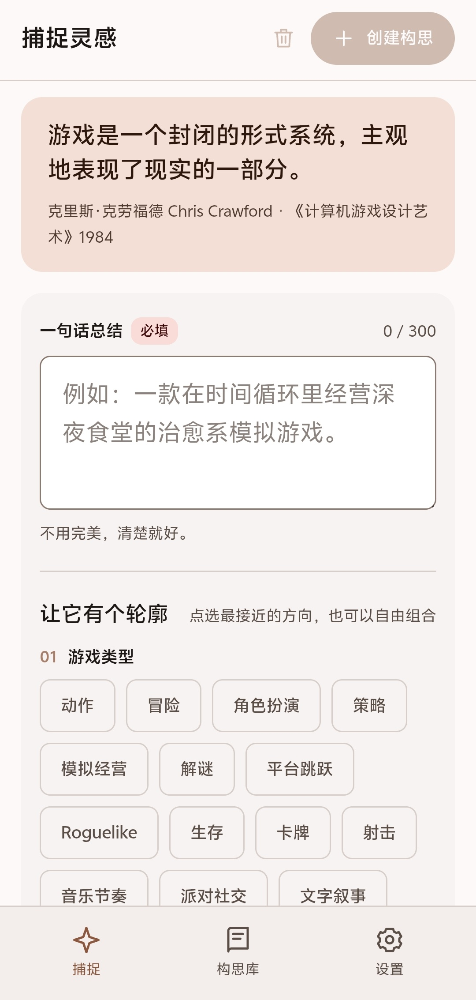
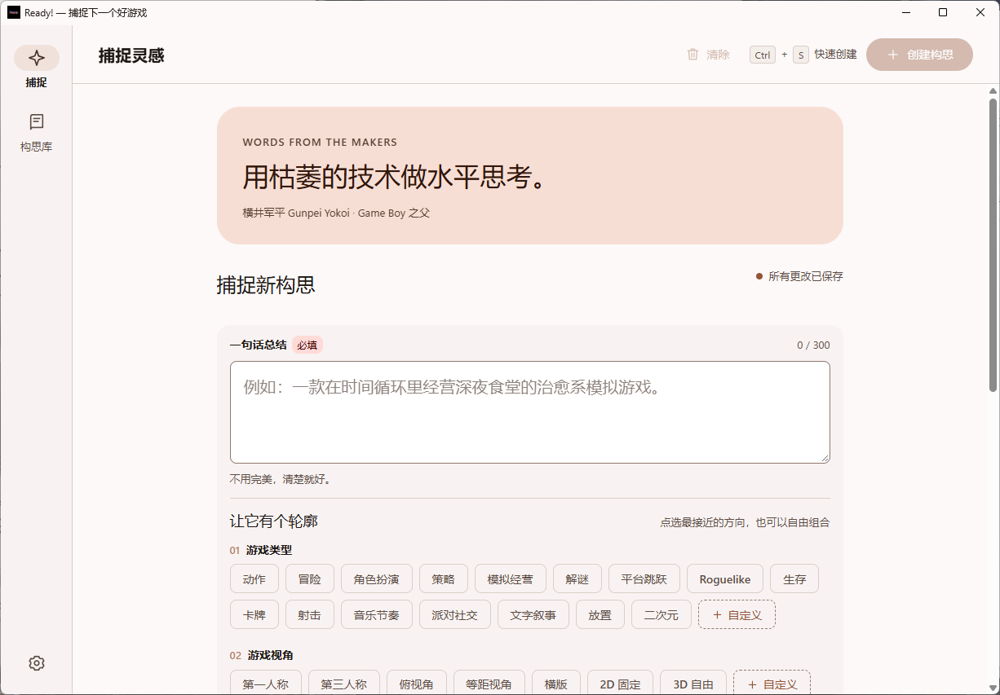

# Ready!

<p align="center">
  
</p>

> Every good game starts with a sentence.

> [!IMPORTANT]
> **This project is made entirely by AI.**
> Requirements, UI design, implementation and documentation were all produced by an AI coding assistant; the human only set the direction, reviewed the results and made the decisions.

Ready! is a **local-first** ideation workbench for game creators. **Android is the primary target** (.NET 10 / .NET MAUI + Blazor Hybrid); Windows is served by a separate WinForms host that shares the exact same Blazor UI.

Fully offline: no network calls, no accounts, no data uploaded anywhere.

[](LICENSE)
[](https://github.com/ChiEdking123/Ready/actions/workflows/ci.yml)
[](https://dotnet.microsoft.com/download/dotnet/10.0)

## Screenshots

<p align="center">
  
  
</p>

## The problem

When a game designer gets an idea, it usually lasts only an instant. Most note-taking tools make you create a document, pick a title, choose a category first — by the time the structure is in place, the spark is gone.

Ready! opens straight into a text field. The one-sentence summary is the only required input; everything else is optional tags you can tap in seconds to give the idea a shape. Detailed design stays collapsed until you actually want to go deeper.

## Features

- **One-sentence summary + quick tags**: genre, perspective, art style, setting, characters — all multi-select and extensible with custom values.
- **Details come later**: references, platform, audience, playtime, core loop, mood, input, scope, resources, non-goals and business model, collapsed by default.
- **Idea library**: search, pin, edit, duplicate, delete and sort. The page opens straight onto the search bar, with no stat cards in front of it.
- **Fully local**: JSON persistence with atomic writes, corrupt-file backup and import/export. Writes queue up serially; a failed write rolls memory back and reports the failure honestly — you never end up with "the UI said saved, the restart says otherwise".
- **Appearance**: light / dark / follow system, five accent palettes, five UI scale steps (desktop also supports `Ctrl` + wheel).
- **Accessible**: dialogs are fully keyboard operable (`Tab` cycles inside, `Esc` cancels).

## Usage notes

- **`Ctrl + wheel`**: scales the whole UI (85%–140%); it is the same value as "UI scale" in settings. Desktop only.
- **Accent color**: switching it also tints the neutrals (background, dividers, body text) toward that hue, with the same ramp in dark mode.
- **Close behavior**: closing asks whether to keep running in the background or exit; the answer applies to that one time unless you tick "don't ask again". Windows only.
- **Android back key**: closes overlays first, then returns to the capture page; on the capture page one press shows "press back again to exit" and only a second press within 2 seconds really exits. An unsaved draft prompts for confirmation first.

## Data and privacy

App data lives in `ready-data.json` inside the OS-provided per-app data directory. No network, accounts or telemetry.

JSON backups contain **created ideas only**; custom tags and settings live in the app's local data but are not part of an idea export.

## Project structure

```text
src/Ready/            # Android head (net10.0-android, primary target)
  Models/             # ideas, settings, tag catalog and export models
  Services/           # local persistence, idea management, source-generated JSON context
  Components/         # shared Blazor UI (the Windows head links the same files)
  Platforms/Android/  # native entry point, safe areas, system bar colors
  wwwroot/            # responsive styles and shortcuts
src/Ready.WinForms/   # Windows head (WinForms + WebView2 on HWND)
tests/Ready.Tests/    # compiles models and storage directly; no Android SDK needed
docs/                 # build, IME and icon-pipeline details
```

## Contributing

Issues and PRs are welcome. Read [CONTRIBUTING.md](CONTRIBUTING.md) and [CODE_OF_CONDUCT.md](CODE_OF_CONDUCT.md) before starting. Report security issues privately via [SECURITY.md](SECURITY.md).

## License

Released under the [MIT License](LICENSE).

Third-party components and their licenses: see [THIRD-PARTY-NOTICES.md](THIRD-PARTY-NOTICES.md).

The code and documentation in this project are AI-generated.
