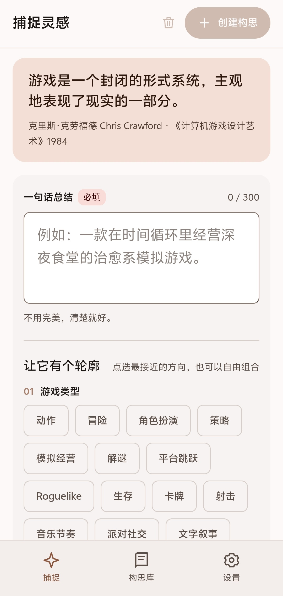
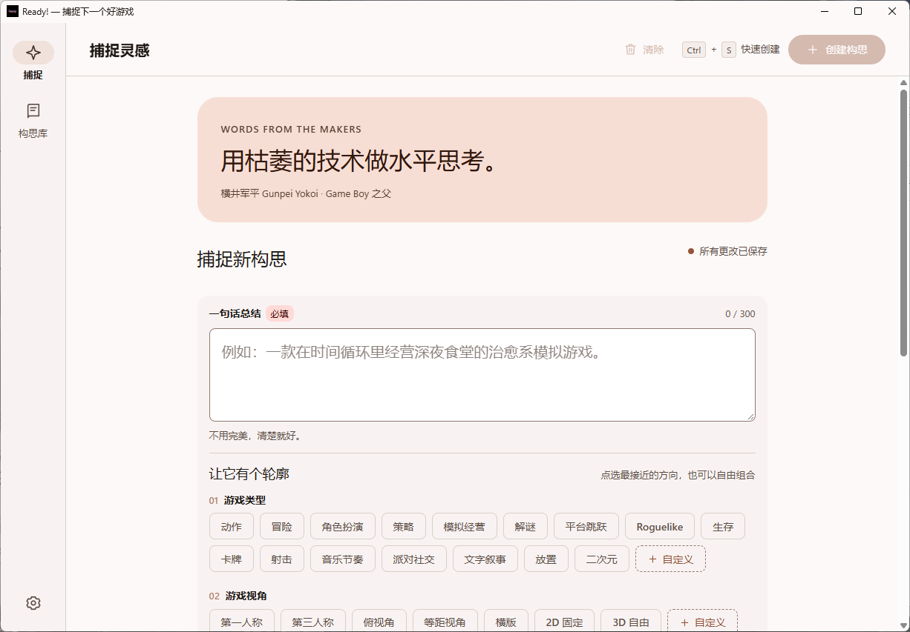

# Ready!

<p align="center">
  
</p>

> 好游戏，从一句灵感开始。

> [!IMPORTANT]
> **本项目由 AI 全程制作。**
> 从需求梳理、界面设计、代码实现到文档撰写，全部由 AI 编程助手完成，人类只负责提出方向、验收结果与做决定。

Ready! 是一个面向游戏创作者的**本地优先**构思工作台。**Android 是主目标**（.NET 10 / .NET MAUI + Blazor Hybrid），Windows 由独立的 WinForms 宿主承载同一套 Blazor 界面。

完全离线：不联网、不登录、不上传任何数据。

[](LICENSE)
[](https://github.com/ChiEdking123/Ready/actions/workflows/ci.yml)
[](https://dotnet.microsoft.com/download/dotnet/10.0)

## 截图

<p align="center">
  
  
</p>

## 它解决什么问题

当游戏开发者想到一个游戏点子的时候，通常只有一瞬间。大多数情况下笔记工具会让你先建文档、想标题、选分类——等理顺结构，那点灵感已经凉了。

Ready! 的做法是：打开就能打字。一句话总结是唯一必填项，其余全是可选的标签，点两下就能给这份想法一个轮廓。详细设计默认折叠，等你真的想往下想的时候再展开。

## 功能

- **一句话总结 + 快速标签**：类型、视角、画面风格、背景设定、角色，全部支持多选与自定义。
- **详细的在后**：参考作品、平台、受众、时长、核心循环、情绪、输入、规模、资源、不做什么、商业模式，默认折叠。
- **构思库**：搜索、置顶、编辑、复制、删除、排序。进入页面直接是搜索栏，没有统计卡挤在前面。
- **完全本地**：JSON 持久化，原子写入、损坏备份、导入导出。写入串行排队，落盘失败会回滚内存并如实报错——不会出现「界面说已保存、重启却是旧内容」。
- **外观**：浅色 / 深色 / 跟随系统，5 种主题色，界面比例五档（桌面端还支持 `Ctrl` + 滚轮）。
- **可访问**：弹出层可全键盘操作（`Tab` 循环、`Esc` 取消）。

## 使用提示

- **`Ctrl + 滚轮`**：缩放整个界面（85% – 140%），与设置里的「画面比例」是同一个值。仅桌面端。
- **主题色**：切换时中性色（背景、分割线、正文）会跟着偏向该色相，深色模式也是同一套色阶。
- **关闭行为**：点关闭会问「留在后台还是彻底关闭」，默认只对这一次生效；勾「下次不再询问」才记住。仅 Windows。
- **安卓返回键**：先关浮层、再回捕捉页；在捕捉页按一次提示「再按一次返回键退出」，2 秒内再按才真的退出。有未创建的草稿时先弹确认。

## 数据与隐私

应用数据保存在操作系统提供的应用专属数据目录下的 `ready-data.json`。不需要网络、登录或遥测。

JSON 备份**仅包括已创建的构思**；自定义标签和设置包含在应用本地数据中，但不包含在构思导出里。

## 项目结构

```text
src/Ready/            # Android 头（net10.0-android，主目标）
  Models/             # 构思、设置、标签目录与导出模型
  Services/           # 本地持久化、构思管理、源生成 JSON 上下文
  Components/         # 共享 Blazor UI（Windows 头链接同一份）
  Platforms/Android/  # 安卓原生入口、安全区、系统栏配色
  wwwroot/            # 响应式样式与快捷键
src/Ready.WinForms/   # Windows 头（WinForms + WebView2，HWND 托管）
tests/Ready.Tests/    # 直接编译模型与存储层，不需要 Android SDK
docs/                 # 构建、输入法与图标流水线的细节说明
```

## 参与

欢迎 Issue 和 PR。开始之前请读 [CONTRIBUTING.md](CONTRIBUTING.md) 与 [CODE_OF_CONDUCT.md](CODE_OF_CONDUCT.md)。安全问题请按 [SECURITY.md](SECURITY.md) 私下报告。

## 许可

以 [MIT License](LICENSE) 发布。

第三方组件与其许可见 [THIRD-PARTY-NOTICES.md](THIRD-PARTY-NOTICES.md)。

本项目的代码与文档由 AI 生成。
